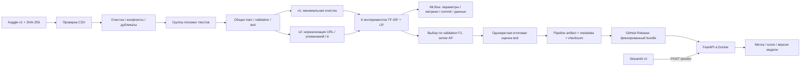
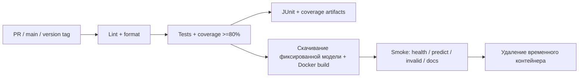

# Архитектура и принятые решения

## Почему такой процесс

1. **Отдельный пакет вместо исполнения notebook.** CLI-команды не зависят от порядка
   ручных действий. Ноутбук исходного исследования остаётся вне runtime проекта.
2. **TF-IDF + Logistic Regression.** Это CPU-модель, удобная для демонстрации полного
   жизненного цикла на MacBook и Linux CI. Исходное исследование показало силу
   символьных признаков; здесь обучаются новые модели, прежние метрики не переносятся.
   BERT не обязателен по заданию MLOps и не включён в контейнер.
3. **Pipeline включает предобработку, TF-IDF и классификатор.** Сервис не собирает
   признаки заново и не обучается на запросах. Оба этапа используют один и тот же код.
4. **Две версии preprocessing, одна популяция и один split.** Контролируемое сравнение
   не смешивает изменения обработки с изменениями тестовых примеров. v2 является
   совокупностью изменений; нельзя приписывать эффект только замене URL.
5. **Нет удаления стоп-слов, мата или отрицаний.** Они могут влиять на токсичность.
   Это зафиксированный выбор, а не доказательство оптимальности без ablation.
6. **C=1 и C=10 для символов, C=1 для слов.** Компактный заранее объявленный бюджет
   сравнивает силу L2-регуляризации и представление. Он не является полным поиском.
7. **min_df=2, max_features=100000, sublinear_tf, L2.** Отсекаем единичные признаки,
   ограничиваем память и влияние повторов. Это ресурсные эвристики; min_df и словарь
   обучаются исключительно на train. Версии библиотек фиксируются uv.lock.
8. **class_weight=balanced, порог 0.5.** Компенсируем дисбаланс при обучении;
   порог не настраивается на test. Score не проходил независимую калибровку.
9. **MLflow + контрольные суммы вместо второго инфраструктурного сервиса.** MLflow
   сохраняет фактические runs. SHA-256 сырого/подготовленных файлов и splits вместе
   с commit и кодом преобразования фиксирует версии данных. DVC не добавляется
   только ради присутствия инструмента.
10. **SQLite локально, переносимые JSON records и Release.** Не нужен внешний
    платный сервер. На другом компьютере `restore-tracking` импортирует реальные
    параметры и метрики, создавая новые локальные run IDs с тегом original_run_id.
    Это импорт истории, а не повторное обучение. Обучение повторяется командой train.
11. **Модель внутри image.** После сборки сервис не скачивает веса и не требует
    доступа к tracking. SHA-256 в API позволяет сопоставить ответ с artifact.
12. **Fail-fast.** Без правильной модели или конфигурации запуск завершается
    понятной ошибкой. Health означает загруженную модель, а не только живой процесс.

## Границы

- Данные собраны с конкретных площадок; перенос на новые темы и аудитории не доказан.
- Косинусная близость 0.95 по hashed 5-граммам — эвристика, не полный поиск перефразировок.
- Удаление противоречивых меток меняет популяцию оценки; качество относится к очищенному корпусу.
- Фильтр 15 символов исключает короткие оскорбления из области применения.
- Ручная модерация и контекст обсуждения остаются необходимыми.
- CD, мониторинг production и автоматическое переобучение в объём этой версии не входят.
